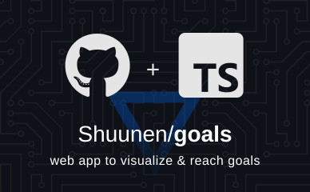
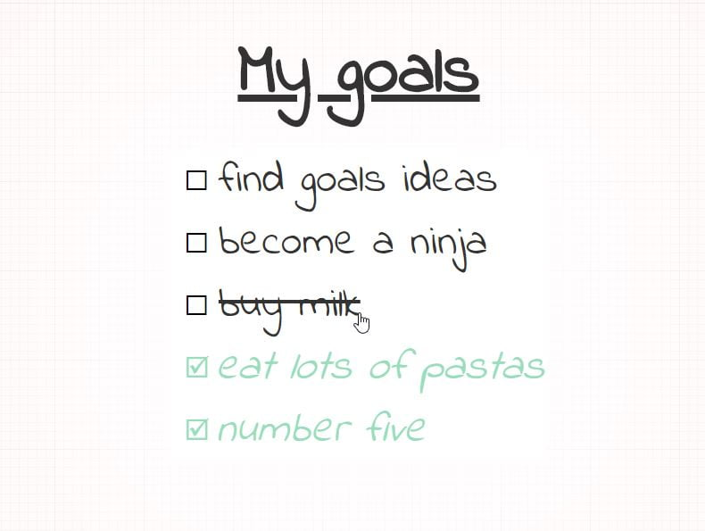

# Goals

> Visualize & reach

## Demo

## Features

- [x] dead simple todo list, goals can be any text : accents, punctuation, emoji, anything
- [x] 100% privacy safe, no analytics, no cookie, no database, list is stored in the url of your tab (and remembered by your browser, only once you change something)
- [x] shareable : give the link to someone [like this one](https://shuunen-goals.netlify.app#My%20goals=become%20a%20ninja,buy%20milk,!eat%20lots%20of%20pastas,find%20goals%20ideas,number%20five&something_else=12), or copy / share it from the settings (a warning tells when the link gets long enough for some apps to cut it)
- [x] a thin progress bar under the title, with a small celebration when the last goal is done
- [x] done goals sink to the bottom of the list, with a smooth slide
- [x] WYSIWYG edit : toggle the pencil to rename the title, rename, add or remove goals in place
- [x] undo : removing a goal, clearing the done ones, reset all, replacing the list or pasting many goals can be undone from the toast
- [x] add goals in a row (Enter or the + button), paste a list to add them all at once (`- [x] done`, `1. numbered`, `* bullets`)
- [x] keyboard friendly : visible focus everywhere, Escape gives back a field, then leaves the edit mode, drag a goal with Space and the arrow keys
- [x] re-order goals by dragging the handle (mouse or touch) or with the up / down arrow keys, with smooth animations
- [x] settings modal (gear icon, a bottom sheet on small screens) : 6 themes plus an auto one following your system (paper, dark, ocean, sunset, forest, rose), 6 fonts (indie, caveat, script, lora, mono, inter), the size, with live previews
- [x] theme, fonts & size are kept in the link too (`&theme=rose&titleFont=lora`), so a shared link looks the same for everyone
- [x] your list : reset all the checks, export as JSON or a Markdown checklist, import from a file or a pasted text, clear everything
- [x] works offline once opened (installable as an app), a toast offers the new version when there is one
- [x] the floating buttons step aside while scrolling, a short haptic tick on a checked goal (where the device can)
- [x] styled print

## Roadmap

- [ ] multiple lists stored locally : switch between lists, so opening a shared link never replaces your own list
- [ ] due dates, notes, sub-goals

## Thanks

- [Boxy Svg](https://boxy-svg.com) : simple & effective svg editor
- [Favicon.io](https://favicon.io/favicon-generator/?t=G&ff=Linden+Hill&fs=120&fc=%23FFFFFF&b=rounded&bc=%230A5) : handy favicon generator
- [Github](https://github.com) : this great, free and evolving platform
- [Knip](https://github.com/webpro/knip) : super tool to find & fix problems
- [Netlify](https://netlify.com) : awesome company that offers hosting for OSS
- [Oxc](https://oxc.rs) : oxlint & oxfmt, a fast linter & formatter suite
- [React](https://react.dev) : the library for web and native user interfaces
- [RIOT Optimizer](https://riot-optimizer.com) : Radical Image Optimization Tool, the best software I found to compress images
- [Shields.io](https://shields.io) : nice looking badges to be proud of
- [Shuutils](https://github.com/Shuunen/shuutils) : collection of pure JS utils
- [Svg Omg](https://jakearchibald.github.io/svgomg/) : the great king of svg file size reduction
- [Tailwind CSS](https://tailwindcss.com) : utility-first CSS framework
- [TailwindCss](https://tailwindcss.com) : awesome lib to produce maintainable style
- [Turborepo](https://turborepo.dev) : high-performance build system for JS/TS
- [V8](https://github.com/demurgos/v8-coverage) : simple & effective cli for code coverage
- [Vite](https://vitejs.dev) : next generation frontend tooling
- [Vitest](https://github.com/vitest-dev/vitest) : super fast vite-native testing framework

## Stargazers over time

